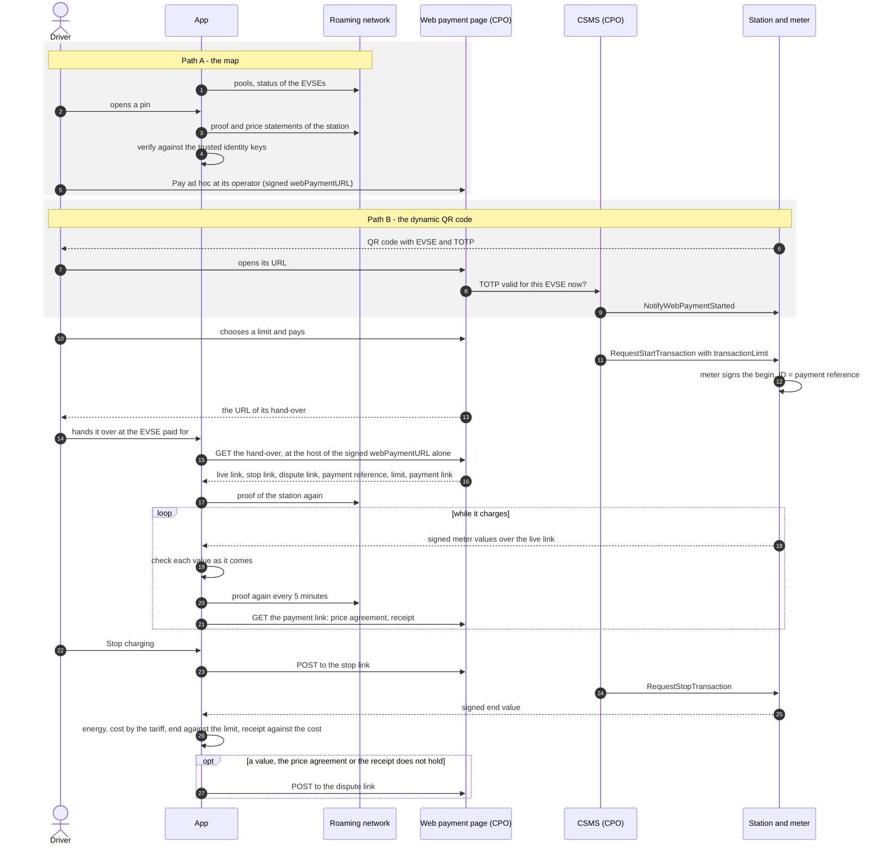

# Ad hoc charging at the charge point operator

How an EV driver charges **ad hoc** - without a contract with an e-mobility
provider (EMP) - and pays the charge point operator (CPO) directly at its
**web payment page**, and how the driver's app checks everything it is told,
from choosing the charge point to the signed end value and the final price.

The app does not pay and does not start anything itself: the web payment page
does both. What the app does is make sure that what the driver sees is what the
CPO signed in its roaming network, and check every signed meter value of the
session with a key it did not get from the CPO.

There are two ways to the web payment page:

- **Path A - the map:** the driver picks a station in the app, the app checks
  it and opens the web payment page the station's signed data names.
- **Path B - the dynamic QR code:** the driver stands in front of the charge
  point and scans the QR code on its display, which changes every few seconds.

From the payment on, both paths are the same.

**Status:** this describes what the [Smartphone](../README.md) does today
(November 2026), and what it expects of the CPO. Steps that happen at the CPO
and not in the app are marked **[CPO]**. What is not covered yet is collected
under [Gaps and open points](#gaps-and-open-points). The same with an
e-mobility provider is [ChargingThroughTheEMP.md](ChargingThroughTheEMP.md).


## The parties and what each one is trusted for

| Who | What it does | What the app trusts it for |
|---|---|---|
| **Driver and app** (Smartphone) | finds the station, hands the session over to the app, stops it, disputes it | - |
| **Roaming network operator (RNO)** | serves the stations of the network as [WWCP_POI](https://github.com/OpenChargingCloud/WWCP_POI) data and attests their state with its identity keys | its identity keys, by the thumbprints in the network's trust anchor - only those an administrator of the phone trusted, each on its own |
| **CPO** | runs the stations, the CSMS and the web payment page; signs its tariffs, its prices and the URL of its page in the roaming network | only what the RNO attests of it: its tariffs, price statements, web payment URL and the public keys of its energy meters |
| **Charging station and its energy meter** | measures the energy and signs every meter value as [OCMF](https://github.com/SAFE-eV/OCMF-Open-Charge-Metering-Format), as German calibration law (Eichrecht) asks | the meter's signature, checked with the key the RNO attested for that meter - never a key the CPO or the live link names |
| **Payment service provider** | takes the money at the page | nothing - the app never sees the payment |


## Three QR codes and URLs, not to be confused

| | What it is | Signed? | Where it comes from |
|---|---|---|---|
| **Trust anchor** | `WWCP/TA-2:…` - the URLs of a roaming network and the thumbprints of its operator's identity keys | no - it is the root of trust itself; a QR code is as trustworthy as the place it was found | the RNO's website or documents |
| **Static web payment URL** | `webPaymentURL` of a station, its pool or its operator | yes - in the station's proof, by a CPO key that may sign `payments` | the station's data in the roaming network |
| **Dynamic QR code** | a URL of one EVSE with a time-based one-time password (TOTP), OCPP 2.1 | no - but only someone in front of the EVSE can read the current one | the display of the charge point |


## Overview




## Step 0 - Once: trusting a roaming network

Before the app believes anything of a station, it has to know which roaming
network it trusts, and whose keys.

1. An administrator of the phone enters the network's **trust anchor** under
   **Configuration → Map**: the text of its QR code (`WWCP/TA-2:…`), its URI
   or its JSON. It names where the network is served, one URL or more, and the
   thumbprints of the identity keys of its operator, with how many of their
   holders have to agree.
2. The app asks the network for its operator's **key statement**
   (`GET …/RNs/{id}/keyStatement`) and shows each key of the anchor with what
   the statement says of it, and whether the statement is signed validly and
   valid now.
3. The administrator **trusts each identity key on its own**, after confirming
   it - best against a second source, such as the RNO's website. Setting an
   anchor trusts none of its keys: a QR code stuck on a charging station may be
   anybody's. Setting the same anchor again keeps the keys trusted; another
   anchor trusts none.
4. Both are kept in `configuration.json`:

   ```json
   "roamingNetwork": {
       "trustAnchor": { "@id": "QA", "urls": [ "https://hub.example/poi/RNs/QA" ], "keys": [ "a1…" ] },
       "trustedKeys": [ { "id": "a1…", "acceptedAt": "2026-11-03T09:00:00.0000000+00:00", "acceptedBy": "admin" } ]
   }
   ```

Everything below is checked against these keys and nothing else. The phone's
clock matters too - attestations hold for minutes - and is kept by NTS
(**Configuration → NTS client**).


## Path A - Choosing a charging station on the map

### A1 - The map shows the stations of the network

- The app lists the charging pools of the network (`GET …/RNs/{id}/CPs`), at
  the URLs of the trust anchor in their order, the next where one does not
  answer, and again every minute or on **Reload**. This list is **not
  signed**: it only says where to look.
- Which charge points are free comes over the WebSocket of the network's
  history (`…/history/ws`): the app subscribes to the admin status and the
  status of the EVSEs, and each pin takes the colour of what its charge points
  are now. This is **not signed** either, and nothing of it is kept once the
  network is not reached: the pins are grey then. Where the network says a
  charge point is taken, reserved or out of service, nothing is started there.
- The search above the map finds a station by its name, street, city, operator
  or **EVSE ID**.

### A2 - Opening a pin checks the station

When a pin opens, the app fetches the **proof** of each of its stations
(`GET …/CSs/{id}/proof`; the app's own API is
`GET /api/v1/map/locations/{id}/check`) and checks it **offline**:

- The proof holds everything the network says of the station - its EVSEs,
  their energy meters with the public keys they sign with, the tariffs they
  take, the web payment URL - in a hash tree.
- The root of that tree is **attested by the RNO for about a quarter of an
  hour**, with a key that one of its identity keys certified.
- It is checked against a trust context of the identity keys trusted on this
  phone, evaluated of the key statement the proof gives, at the time of the
  check - so a quorum of the trusted holders has to agree.

A proof that does not hold, or whose attestation has run out, shows nothing of
the station: nothing is charged at a station nobody trusted here attested.

### A3 - The price

The app fetches the **price statements** of the station
(`GET …/CSs/{id}/priceStatements`) - new prices the CPO signed after the
tariff - and checks them against the keys the proof gives for the CPO, each on
its own and then all together. Of each entity the statement in force is taken.
Where two of one sequence contradict each other (a *split view*), none is
taken, and the price is **not known**.

The price of a charge point is the price statement of its **EVSE**, else of
its **station**, else of its **pool**, else its **tariff**. This is the price
the app will count the session with - unless the CPO binds another one in
force at the start to the session in a price agreement
([Step 6](#the-price-agreement-and-the-receipt)).

### A4 - "What is signed about it"

The pin says whether the station is signed and leads to **What is signed about
it**: who attested it and until when, each charge point's tariff and price, its
energy meter with the public key it signs with, and the web payment page of
its operator.

### A5 - Opening the web payment page

The **web payment URL** (`webPaymentURL` of WWCP_POI) is the station's own,
else its pool's, else its operator's. It is signed by a CPO key that may sign
`payments` - whoever changes it redirects payments. The popup offers it as
**Pay ad hoc at its operator** for the station of the charge point chosen. Only
an `https` URL is linked; any other is only shown.

This static URL names no EVSE: the page learns which one the driver wants some
other way, e.g. by asking. Continue with [Step 1](#step-1---cpo-paying-and-starting-at-the-web-payment-page).


## Path B - Scanning the dynamic QR code

### B1 - [CPO] The charge point shows a QR code that changes

This is OCPP 2.1 use case C25, *"Ad hoc payment via a QR code"*. The station's
`WebPaymentsCtrlr` fills its `URLTemplate` with the EVSE and a time-based
one-time password, e.g.

```
https://pay.example/{evseId}/{TOTP}/v1   →   https://pay.example/DE*GEF*E2*1/aHicux89zt2K/v1
```

and may add `{maxEnergy}`, `{maxCost}`, `{maxTime}` and others. The TOTP is
derived from a `SharedSecret` that only the station and its CSMS know, and from
the current time slot (*"TOTP algorithm, version 1"*: HMAC-SHA256, Base62, 12
characters by default). It changes with every slot of its `ValidityTime` -
30 seconds by default in the OpenChargingCloud implementation, between
6 seconds and an hour - and the display shows the new code.

The algorithm is specified with test vectors in
[Whitepapers → TimeBasedOneTimePasswords](https://github.com/OpenChargingTechnology/Whitepapers/tree/master/TimeBasedOneTimePasswords)
and implemented in [Hermod](https://github.com/Vanaheimr/Hermod) (`Hermod/TOTP`)
and [TOTP.ts](https://github.com/OpenChargingCloud/TOTP.TS); see also
[DynamicQRCodes](https://github.com/OpenChargingCloud/DynamicQRCodes).

### B2 - The driver scans it

With the phone's camera. The browser - not the app - opens the URL: the CPO's
web payment page for exactly this EVSE.

### B3 - [CPO] The CSMS checks the one-time password

The CSMS computes the previous, the current and the next one-time password of
that EVSE and accepts the one presented only where it equals one of them,
compared in constant time, and remembers it for its slot. That shows that
whoever opened the page **stands in front of that EVSE now**: a photo of the
code is useless a slot later, and a static QR code glued over the display, or a
link passed around, does not validate.

The CSMS then tells the station with OCPP 2.1 `NotifyWebPaymentStarted` (the
EVSE and a timeout) that a payment has started there, so that it can say so on
its display.

### B4 - Checking the station in the app as well (recommended)

The dynamic QR code is not signed by anybody and is no part of the station's
proof. So, before paying, the driver opens the same station in the app - the
search finds it by the EVSE ID printed at the charge point - and the app checks
it exactly as in [A2](#a2---opening-a-pin-checks-the-station) to
[A4](#a4---what-is-signed-about-it): the signed price, the meter's key and the
signed web payment URL. The app needs this station checked anyway to take over
the session in [Step 2](#step-2---handing-the-session-over-to-the-app).


## Step 1 - [CPO] Paying and starting at the web payment page

What the page, its CSMS and its stations have to do for the app - the live
link endpoints, what the meter signs, the POSTs to the stop and the dispute
link and their answers, the price agreement and the receipt at the payment
link - is [WebPaymentPageInterface.md](WebPaymentPageInterface.md).

1. The page shows the EVSE and the price. It should be the signed price of
   [A3](#a3---the-price): the app counts with that one, not with what the page
   says.
2. The driver chooses a **limit** and pays, e.g. with a pre-authorization at
   the payment service provider.
3. The CSMS starts the transaction with OCPP 2.1 `RequestStartTransaction`,
   the limit as its `transactionLimit` - `maxEnergy` in Wh, `maxCost` in the
   currency of the tariff, `maxTime` in seconds, `maxSoC` in percent - and the
   station keeps to it.
4. The station writes the **reference of the payment** into the identification
   of every meter value it signs for the session (OCMF `ID`), so that the meter
   signs whose session it is.
5. The page gives the driver a **hand-over**: one JSON document, at an `https`
   URL of this session alone on the host of the page, which names all of the
   following - or, where it gives none, each of them on its own:

| | What it is | |
|---|---|---|
| **live link** | a [Charge Transparency LiveLink](https://github.com/OpenChargingCloud/ChargyCore.NET/tree/master/documentation/ChargeTransparencyLiveLink) document, or the https URL of one: where the signed meter values of the session come from, over https polling, Server-Sent Events or a WebSocket | required |
| **stop link** | an https URL of this session alone; a POST to it stops the session | optional |
| **dispute link** | an https URL of this session alone; a POST to it disputes the session | optional |
| **payment reference** | the reference of the payment, as the station writes it into OCMF `ID` | optional, but without it the values are not proven to be of this session |
| **limit** | the limit chosen, as OCPP 2.1 says it | optional |
| **payment link** | an https URL of this session alone; a GET to it gives the price agreement of the CPO for the session and the receipt of what the page took | optional, but without it the price is not bound to the session, nor is what was taken compared with the cost |

```json
{
  "@context":          "https://open.charging.cloud/contexts/wwcp/webPayment/handOver/v1",
  "liveLink":          "https://pay.gef.example/liveLinks/4711",
  "stopLink":          "https://pay.gef.example/sessions/4711/stop?key=9f2c...",
  "disputeLink":       "https://pay.gef.example/sessions/4711/dispute?key=41ab...",
  "paymentReference":  "GEF-2026-11-09-0815",
  "limit":             { "maxEnergy": 20000 },
  "paymentLink":       "https://pay.gef.example/payments/4711?key=77d0..."
}
```

The stop link, the dispute link and the payment link work for whoever has
them, so they are secrets of the session - and so is the URL of the hand-over,
which names them.
What else a hand-over must and should be is
[WebPaymentPageInterface.md, The hand-over](WebPaymentPageInterface.md#the-hand-over).


## Step 2 - Handing the session over to the app

In the popup of the station, at the charge point paid for, the driver enters
the URL of the hand-over the page gave: **Paid there? The hand-over its page
gave**. The app takes the hand-over from the **host of the web payment page**
the proof of the station names - the signed `webPaymentURL` of
[A5](#a5---opening-the-web-payment-page), port included - and asks no other
host. Where the page gives no hand-over, the driver enters the live link, the
stop link, the dispute link, the payment reference, the limit and the payment
link on their own instead. The app's API takes either:

```http
POST /api/v1/charging/sessions
Content-Type: application/json

{
  "locationId":  "DE*GEF*P1",
  "evseUid":     "DE*GEF*E2*1",
  "handOver":    "https://pay.gef.example/handOvers/4711"
}
```

```http
POST /api/v1/charging/sessions
Content-Type: application/json

{
  "locationId":       "DE*GEF*P1",
  "evseUid":          "DE*GEF*E2*1",
  "liveLink":         "https://pay.gef.example/liveLinks/4711",
  "stopLink":         "https://pay.gef.example/sessions/4711/stop",
  "disputeLink":      "https://pay.gef.example/sessions/4711/dispute",
  "paymentReference": "PAY-2026-11-09-0815",
  "limit":            { "maxEnergy": 20000, "maxCost": 15.00 },
  "paymentLink":      "https://pay.gef.example/payments/4711"
}
```

`handOver` beside one of the others is refused (`400`). It may also be the
hand-over document itself, pasted.

The app takes it over only where

- a roaming network is set, and the station and its EVSE are on the map
  (`404` otherwise);
- the station **was checked and its proof holds now** (`409`);
- the phone is not charging at that EVSE already (`409`);
- a hand-over at a URL is at the host of the web payment page the proof names,
  and the proof names one (`409`, before anything is asked), and answers there
  with a hand-over: a JSON document naming its `@context` and its `liveLink`
  (`400`; `502` where the host could not be reached);
- the live link is one: given as its document, or fetched from its `https`
  URL, and recognized by ChargyCore as a Charge Transparency LiveLink (`400`;
  `502` where its URL could not be reached);
- the live link names no other charge point than the one it is handed over at
  (its `chargingStation.EVSE["@id"]`; `409`: *handed over at the wrong charge
  point*);
- the stop, dispute and payment links are `https` URLs, the payment reference a text of
  at most 255 characters without control characters, and the limit uses
  OCPP 2.1's names and units (`400`).

**What is the CPO's.** The host of the web payment page is in the station's
proof, signed by a CPO key that may sign `payments`, and TLS proves who answers
there. So the **payment reference** of a hand-over the app took from that host
is the CPO's, and so is every **stop, dispute and payment link at that host**,
however it came. A link at another host, and a payment reference typed or
pasted - a pasted hand-over among it - are the word of whoever gave them. The
session's page says which is which. Nothing of the hand-over itself is signed.

Then the session exists, `201`. It keeps, as **evidence**, the proof of its
station checked before and the price statements that held - the prices in
force at its start are fixed from now on - and the app asks for the proof once
more right away, so that the first signed values are covered even where the
first attestation runs out soon. Where the page gave a payment link, the app
starts asking it ([Step 6](#the-price-agreement-and-the-receipt)). The session
is kept in `charging-sessions.json`; a restart of the phone follows it on. Of
the hand-over and the links only the host is shown and logged.


## Step 3 - Following the live link while it charges

- The app follows the live link with
  [ChargyCore.NET](https://github.com/OpenChargingCloud/ChargyCore.NET), over
  the transport it names: `https` (asked again as its `refresh` says - 10
  seconds where it says nothing), `httpSSE` or `websocket`.
- Every signed document that comes is **kept as it came** - the first, the one
  with the start, and the latest ones, a thousand at most.
- The session is **starting** until the first signed document comes,
  **charging** from then on, and **finished** once the meter signs the end of
  the transaction or the station ends the stream.
- Public keys the live link document carries itself are **not used**: they come
  from the same CPO as the values they would verify, which would prove
  consistency, not authenticity.
- While it charges, the app asks for the **proof of the station every five
  minutes**, and once more at the end. It keeps three at most: the one of the
  start, the first after it, and the latest - so that there is a proof that
  covers the time of every meter value.
- The session's page shows the energy (the latest register less the first that
  counts), the cost (what its tariff makes of what was charged when, part by
  part - see [Step 6](#the-final-price)), and each part of the limit against
  what the signed values say.


## Step 4 - Checking every signed meter value as it comes

Each value is checked as it comes, in this order: the **start value** - the
first reading the meter signs as the begin of the transaction (OCMF `TX` =
`B`) -, every value after it, and the **end value** last, alone or as the
whole transaction from its begin.

| # | Check | A wrong value where |
|---|---|---|
| 1 | **The meter's key:** the key the proofs kept attest for the energy meter of this EVSE at the time the value was measured (WWCP_POI's `HistoricalMeterEvidence`) - between the start and the end, or a key of the operator for its charge transparency records (see below) | it is of another meter (`MS`) than the proof names for the EVSE, or signed by another key |
| 2 | **The signature,** with that key, by ChargyCore | it does not verify |
| 3 | **This payment:** its `ID` is the payment reference handed over | it names another payment, or none |
| 4 | **The meter says it is good:** status `ST` = `G`, no error flags `EF` (`E` energy, `t` time) | the meter says otherwise |
| 5 | **An energy register:** `RV` in `kWh` or `Wh` | there is none |
| 6 | **One begin:** a begin it says again - the whole transaction, at its end - is the start value that held | it says another begin |
| 7 | **In order:** nothing measured before the start value, the meter counting forwards, one time one value | it does not fit the values that held before, or its own readings |
| 8 | **Nothing after the end:** no reading after one that ends the transaction (`TX` = `E`, `L`, `R`, `A`, `P`) | there is one |

**Values between, signed by the operator.** Many stations have their meter
sign only the start and the end, and sign the values between with a key of the
operator - which a Charge Transparency LiveLink allows. The app takes such a
value where:

- its key is a **signing key of the operator** of the station that the proof
  attests, valid at the time the value was measured, and that may sign the
  operator's **charge transparency records** - it names the usage
  `chargeTransparencyRecords`, or none (WWCP_POI's
  `AuthorizedChargingDocumentKeys`). A key for price statements alone is none;
  nor is a key the live link names;
- it names the meter the proof names for the EVSE (`MS`);
- it is **between the start and the end**: no start value, and none of its
  readings ends the transaction. A begin it says again counts only as the
  start value the meter signed says it - and is not decided while none held.

Everything else in the table holds for it as for the meter's. A start value or
an end value the operator signed is a **wrong** one. The page shows such a
value as the operator's: it shows how the session goes, and **counts for
nothing**. What was charged, the cost and the end against the limit are worked
out of what the meter signed alone.

A value **holds**, is **wrong**, or is **not decided**: where the identity
keys trusted here do not suffice, or no proof kept attests a key of the meter
for that time, the app says so, stops nothing, and checks again with what
comes next - an end value with the proof of the station asked for once more.

A **wrong value before the end** stops the session:

1. the app marks the session stopped, says why, and follows its live link no
   more;
2. it sends a POST to the stop link with why (`{ "reason": "…" }`) - where the
   page gave none, or did not take it, the driver is told to stop the session
   at the page;
3. it disputes the session ([Step 7](#step-7---disputing)).

A wrong value counts for nothing: the energy, the cost and the limit are what
the values that hold say.


## Step 5 - Stopping

- **By the driver:** **Stop charging** in the app
  (`POST /api/v1/charging/sessions/{id}/stop`, with `{ "stopLink" }` where it
  was not handed over before). The app sends a POST of `{}` to the stop link;
  the page takes it with a `2xx`. The session charges on until the meter signs
  its end, and is *stopped* then. Where the page gave no stop link, the driver
  stops the session at the page.
- **[CPO]** The page has the CSMS stop the transaction (OCPP
  `RequestStopTransaction`), and the meter signs the end.
- **By the limit, the vehicle or the station:** the station ends the
  transaction itself, e.g. at the limit, and the meter signs the end with the
  reason (`TX`).


## Step 6 - The end value, the energy and the final price

### The end value

The end value is the reading that ends the transaction (`TX` = `E`, `L`, `R`,
`A` or `P`). It is checked as every value is, with the proof of the station
asked for once more.

### The energy

**Energy = the signed end register − the signed start register**, both
verified with the meter's key from the proofs. A wrong value counts for
nothing: of a wrong end value, the energy is up to the latest value that holds.

### The final price

- **The tariff** the session is charged by is the one its CPO agreed for it in
  a price agreement that holds (below), else the first tariff of its EVSE the
  proof names that prices anything, its elements as the price statement in
  force at the start sets them ([A3](#a3---the-price)).
- **The cost** is what that tariff makes of what the meter signed when, as
  OCPI prices a session: energy per kWh, a flat fee, the time charging and the
  time parked - between two signed values whose register did not grow -, each
  where its restrictions hold (times of day, dates and days of the week in the
  time zone of the station's pool; energy, duration and power so far), rounded
  up in its step size, with its VAT, between the least and the most the tariff
  says. The session's page shows it part by part. A restriction or a component
  of current - which no meter value says - makes the cost **not exact**, and
  the page says why. The rules are
  [WebPaymentPageInterface.md, 7](WebPaymentPageInterface.md#7-the-price-and-the-cost).
- All of it is checked again whenever the session's page is shown, **under the
  identity keys trusted now**: a key no longer trusted checks nothing of a
  session, whatever it attested at its start.

### The price agreement and the receipt

Where the page gave a **payment link**, the app asks it from the hand-over on -
again and again, at pauses growing from 5 seconds to 10 minutes, until the
receipt came, and no longer than 7 days after the end. **Ask its payment now**
on the session's page (`POST /api/v1/charging/sessions/{id}/payment`) asks it
at once. The page answers with:

- the **price agreement** - WWCP_POI's `SessionPriceAgreement`, signed by the
  CPO with a key the proof attests that may sign `priceStatements`: a tariff
  and the price statement in force at the start, assigned to this very session,
  named by its EVSE, its meter, when the start value says it began and the
  SHA-256 of that start value as it came. The app checks it once the start
  value held. Where it holds, the price is **bound** to the session, and the
  session is charged by the tariff it agreed; where it does not, the session is
  disputed.
- the **receipt** of what the page took: its amount with VAT, its currency and
  the payment reference - signed by the CPO with a key that may sign
  `payments`, or not signed at all. The app checks it once the end value was
  decided: of this EVSE and this payment, in the currency of the tariff, its
  signature where it has one, and **not more than the cost** the app works
  out. A receipt of more, or one that does not hold otherwise, disputes the
  session. Where the cost is not exact, nothing is decided.

What came first is kept: a later agreement or receipt replaces nothing. What
both must be is
[WebPaymentPageInterface.md, 6](WebPaymentPageInterface.md#6-the-payment-link).

### The end against the limit

Once the meter signs the end, or the station ends the stream, the app says how
the session ended against the limit chosen at the page:

| | |
|---|---|
| **stopped** | stopped by this phone |
| **limit** | it ended at its limit - within 1 % of it, as the station counts from its own start and rounds its own cost |
| **other** | it ended for another reason, as the meter says (`E` ended, `L` at the station, `R` remotely, `A` aborted, `P` power failure) |
| **unknown** | only a state-of-charge limit would have ended it, and no meter measures a state of charge |
| **wrong** | the signed end value is a wrong one, and says nothing |

### What is not proven

The session's page says so, rather than pretending:

- that the **meter's clock** was right - the times are those the meter signed;
- where no price agreement came or held: that the CPO **assigned this price to
  this very session** - it signed no such assignment;
- where the receipt is not signed: **what the page took** - the receipt is the
  page's word then;
- without a payment reference: that the values are **of this very session** -
  the live link names the charge point alone;
- that the version of the proof was the latest one.


## Step 7 - Disputing

The app disputes a session where

- a value before the end was a wrong one (it stopped the session for it),
- the signed end value is a wrong one,
- the station ended the stream of the live link and its meter signed no end,
- the price agreement does not hold, or
- the receipt does not hold - the page took more than the cost, or another
  payment.

It sends a POST to the **dispute link** with why, and the signed values it
disputes as they came - the start value, and the wrong one, the last one, or
the end value where the payment is disputed - with the price agreement or the
receipt that does not hold, as it came:

```json
{
  "reason":       "It is of another session: it names \"PAY-0816\" as the identification of the charging (\"ID\") …",
  "signedValues": [ "OCMF|{…start…}|{…}", "OCMF|{…disputed…}|{…}" ]
}
```

The page takes it with a `2xx`. The app sends it once it knows, and after a
restart where it was not sent yet; one the page did not take is sent again
where the driver asks (`POST /api/v1/charging/sessions/{id}/dispute`, with
`{ "disputeLink" }` where it was not handed over before). Where the page gave no
dispute link, the driver is told to dispute the session at the page.


## In short: what the driver can rely on

| Claim | Proven by | Requires |
|---|---|---|
| the station, its meters and its prices are what the CPO published | the proof, attested by the RNO, verified against the identity keys trusted on the phone | the right keys trusted in Step 0 |
| the web payment page is the CPO's (path A) | `webPaymentURL` in the proof, signed by a CPO key that may sign `payments` | - |
| the payment reference and the links are the CPO's | a hand-over taken from the host of that `webPaymentURL`, over TLS | the page gives a hand-over there, its links at that host |
| the payer stands in front of this EVSE (path B) | the TOTP of the dynamic QR code, checked by the CSMS | the CPO checks it |
| every meter value is the meter's | its signature, with the key the RNO attested for the meter at that time | a proof covering its time |
| the values are of this payment | the payment reference in OCMF `ID`, signed by the meter | the page gives the reference, the station signs it |
| the energy | signed end register − signed start register | both values hold |
| the price is this session's | the price agreement, signed by the CPO with a key the RNO attests for `priceStatements` | the page gives a payment link, and an agreement there |
| the cost | what the signed tariff makes of what the meter signed when - every part, with its restrictions, step sizes and VAT | the values it is worked from hold; exact only where nothing of it depends on the current |
| the page took no more than the cost | the receipt, compared with the cost | the page gives a receipt; signed by the CPO with a key for `payments`, else it is the page's word |
| the session ended where it should | the end against the limit chosen | - |


## Gaps and open points

- **The app does not read the dynamic QR code.** It is opened by the browser;
  the app does not take the EVSE ID out of it, and does not compare the host of
  its URL with the signed `webPaymentURL` - the format of the URL is the CPO's
  own template, and nothing says the two have to be the same site.
- **The driver still carries the hand-over** from the page to the app, as one
  URL to copy: there is no app link the page redirects to, and no QR code of it
  the app scans. Nor does a static `webPaymentURL` tell the page which EVSE was
  picked in the app.
- **Not everything is bound to the CPO:** a link at another host than that of
  the web payment page, and a payment reference typed or pasted, are the word
  of whoever gave them. Binding them would take the CPO signing the hand-over
  with a key the roaming network attests for `payments`.
- **The hand-over, the stop link, the dispute link, the payment link, the
  receipt and the payment reference are conventions** of this family - a
  hand-over, a payment and a receipt of their own `@context`, a POST of JSON
  taken with a `2xx` - and no standard. A Charge Transparency LiveLink carries
  none of them yet.
- **The price agreement and the receipt are optional:** without a payment link
  the price is not bound to the session and what the page took is not
  compared; an unsigned receipt is the page's word. The first agreement and
  receipt are kept: a page that corrects one replaces nothing.
- **The price the page showed** is not compared with the signed one, nor is
  the tariff the meter signs (OCMF `TT`).
- **A flat fee** is not taken by WWCP_POI's simple profile of gross rates
  (`chargy-gross-rates/v1`): a price agreement of it binds the price all the
  same, of a profile WWCP_POI does not establish the rates of.
- **A restriction or a component of current** is priced at nothing - no meter
  value says the current -, and the cost is not exact then: a receipt is not
  decided against it.
- **Values signed by the operator** between the start and the end are taken
  with a key of the operator the proof attests for its charge transparency
  records (Step 4). WWCP_POI has no usage of its own for meter values: one key
  for `chargeTransparencyRecords` signs the operator's whole documents and its
  meter values alike. And only keys of P-256 are taken, as for the meter.
- **A state-of-charge limit** cannot be checked: no meter measures it.
- **The payment reference in OCMF `ID`** is up to the station and its CSMS;
  the app only checks that it is there.
- **The CPO side** - the web payment page, the TOTP check, the start with its
  limit, the hand-over, the live link, the stop, dispute and payment links, the
  price agreement and the receipt - exists in
  this repository only as the stand-in of the tests
  ([`SmartphoneTests/TestCPO.cs`](../SmartphoneTests/TestCPO.cs)). What it has
  to do is [WebPaymentPageInterface.md](WebPaymentPageInterface.md).


## Where it is in the code

| Step | |
|---|---|
| 0 | [`Smartphone/Roaming/RoamingNetworkConfiguration.cs`](../Smartphone/Roaming/RoamingNetworkConfiguration.cs), [`KeyStatementCheck.cs`](../Smartphone/Roaming/KeyStatementCheck.cs) |
| A1 | [`Smartphone/Roaming/RoamingNetworkClient.cs`](../Smartphone/Roaming/RoamingNetworkClient.cs), [`RoamingNetworkStatus.cs`](../Smartphone/Roaming/RoamingNetworkStatus.cs), [`Frontend/src/pages/map.ts`](../Smartphone/Frontend/src/pages/map.ts) |
| A2-A5 | [`Smartphone/Roaming/StationCheck.cs`](../Smartphone/Roaming/StationCheck.cs) |
| 2 | [`Smartphone/HTTPAPI/SmartphoneHTTPAPI.Charging.cs`](../Smartphone/HTTPAPI/SmartphoneHTTPAPI.Charging.cs), [`Smartphone/Smartphone.LiveLinks.cs`](../Smartphone/Smartphone.LiveLinks.cs), [`Smartphone/Charging/WebPaymentHandOver.cs`](../Smartphone/Charging/WebPaymentHandOver.cs) |
| 3 | [`Smartphone/Charging/LiveLinkFollow.cs`](../Smartphone/Charging/LiveLinkFollow.cs), [`Smartphone/Smartphone.Evidence.cs`](../Smartphone/Smartphone.Evidence.cs), [`Charging/SessionEvidence.cs`](../Smartphone/Charging/SessionEvidence.cs) |
| 4 | [`Smartphone/Charging/SessionCheck.cs`](../Smartphone/Charging/SessionCheck.cs) |
| 5, 7 | [`Smartphone/Smartphone.LiveLinks.cs`](../Smartphone/Smartphone.LiveLinks.cs) |
| 6 | [`Smartphone/Charging/LiveLinkEnding.cs`](../Smartphone/Charging/LiveLinkEnding.cs), [`TransactionLimit.cs`](../Smartphone/Charging/TransactionLimit.cs), [`ChargingSession.cs`](../Smartphone/Charging/ChargingSession.cs), [`TariffCost.cs`](../Smartphone/Charging/TariffCost.cs); the payment link: [`Smartphone/Smartphone.Payments.cs`](../Smartphone/Smartphone.Payments.cs), [`Charging/WebPaymentReceipt.cs`](../Smartphone/Charging/WebPaymentReceipt.cs), [`SessionCheck.cs`](../Smartphone/Charging/SessionCheck.cs) |
| Tests | [`SmartphoneTests/ChargingTests.cs`](../SmartphoneTests/ChargingTests.cs), [`RoamingNetworkTests.cs`](../SmartphoneTests/RoamingNetworkTests.cs), [`TariffCostTests.cs`](../SmartphoneTests/TariffCostTests.cs), [`TestCPO.cs`](../SmartphoneTests/TestCPO.cs), [`TestRoamingNetwork.cs`](../SmartphoneTests/TestRoamingNetwork.cs) |
