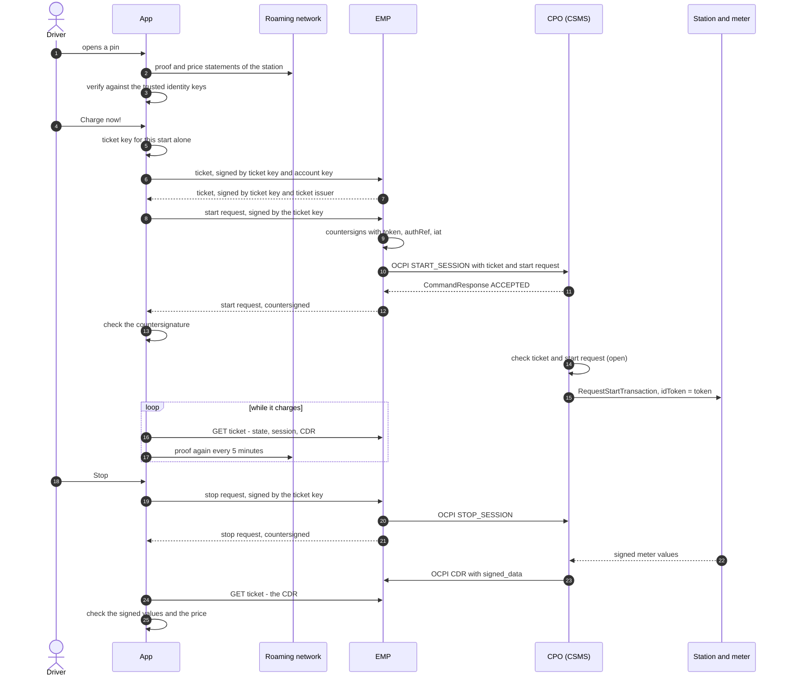

# Charging through an e-mobility provider

How an EV driver with a contract at an **e-mobility provider (EMP, EMSP)**
charges at a station of a charge point operator (CPO), and how the driver's
app checks what it is told, from choosing the charge point to the signed meter
values and the final price of the charge detail record (CDR).

The app starts and stops the session itself, **through the EMP**, with a
**charging ticket** of its own for every start. The CPO learns which EMP pays,
and not who charges: nothing it sees links the session to the driver's
account, nor two sessions to each other. The EMP still vouches for the start
in a way the CPO can keep.

This is the walk through it, step by step. How the ticket, the start request
and the stop request are built - their CBOR, their COSE signatures - is the
draft [RemoteStartWithChargingTickets.md](RemoteStartWithChargingTickets.md);
the same session paid ad hoc at the CPO is
[AdHocChargingAtTheCPO.md](AdHocChargingAtTheCPO.md), and with a ticket the app
shows to the station itself, over NFC or BLE,
[ChargingWithATicketAtTheStation.md](ChargingWithATicketAtTheStation.md).

**Status: a draft, with gaps.** The app's side and the EMP's side exist; the
CPO's side and a roaming hub in between do not yet. Steps are marked by who
does them - **[App]**, **[EMP]**, **[CPO]** -, and what is not settled is
marked **Open**, and collected under
[Gaps and open points](#gaps-and-open-points).

## The parties and their keys

| Who | Key | What it is trusted for |
|---|---|---|
| **The driver's account at the EMP** | an **account key**, P-256, made on the phone, long-lived | "this is me" - to the EMP alone, which certified it |
| **One start** | a **ticket key**, P-256, made on the phone for this one start and thrown away after it | "I hold this ticket" - to the CPO, as the ticket names the key and the EMP signed the ticket |
| **The EMP** | its **ticket issuer key** | "this EMP issued this ticket, vouches for this start and pays for it" - to the app and to the CPO |
| **The roaming network operator (RNO)** | its identity keys, by the thumbprints in the trust anchor | what the network says of the station: its EVSEs, tariffs, prices, energy meters and their keys - to the app |
| **The station's energy meter** | its signing key, attested by the RNO in the station's proof | the signed meter values (OCMF) - to the app, checked with the attested key only |

The account key never reaches the CPO. The ticket key never leaves the phone.

## How it differs from charging ad hoc

| | Ad hoc at the CPO | Through the EMP |
|---|---|---|
| who starts | the CPO's web payment page | the app, through the EMP (OCPI `START_SESSION`) |
| who pays | the driver, at the page | the EMP bills the account; the CPO bills the EMP |
| what the CPO learns of the driver | what the payment tells it | the EMP, a ticket, and a token used for this start alone |
| signed meter values reach the app | while it charges, over the live link | after it ended, in the CDR - **Open:** while it charges |
| what the meter signs as `ID` | the payment reference | the token of the start, or the ticket's id |
| a limit | chosen at the page, `transactionLimit` | the ticket's limits - **Open:** none chosen yet |
| stopping | the stop link of the page | a stop request, signed by the ticket key and countersigned by the EMP |
| disputing | the dispute link of the page | **Open** |
| the price checked | the price of the proof at the start × the signed energy | the price statement in force at the start, against the CDR's `total_cost` |

## Overview

## Step 0 - Once: trusting a roaming network

Exactly as for ad hoc charging:
[Step 0 there](AdHocChargingAtTheCPO.md#step-0---once-trusting-a-roaming-network).
An administrator of the phone sets the trust anchor of the roaming network and
trusts its identity keys, each on its own, after looking at the key statement
of its operator.

## Step 1 - Once: an account at the EMP

Under **Configuration → E-mobility provider**, by an administrator of the
phone - it is whose money is charged:

1. **[App ↔ EMP] Sign up or sign in.** The phone signs up itself
   (`POST /ext/auth/signup`), with a password it makes up and keeps, which
   nobody has to type; or signs in with an account the driver made in a
   browser (`POST /ext/auth/login`), its password kept from then on. The
   session handed out is taken anew where the EMP says it is over.
2. **[App ↔ EMP] An account key.** The phone makes a P-256 key and sends a
   PKCS#10 signing request (`POST /api/v1/account-keys`); the EMP certifies
   the key below its account CA. The private key never leaves the phone.
3. **[App] The EMP's ticket issuer**, as the EMP names it at the sign-in: the
   certificate whose key the app checks every ticket and every countersignature
   with.
4. **[App]** All of it is kept in `provider/` beside the configuration, a
   directory nobody but the account the phone runs under may read.
   **Forget this account** takes the account key back at the EMP and deletes
   the file - not while a session started through the EMP charges.

## Path A - Choosing a charging station on the map

1. **[App]** The map, the pin and the check of the station are those of ad hoc
   charging: [A1 to A4 there](AdHocChargingAtTheCPO.md#path-a---choosing-a-charging-station-on-the-map).
   The proof is verified against the trusted identity keys, the price
   statements against the keys the proof gives, and the price of the charge
   point is the statement of its EVSE, else of its station, else of its pool,
   else its tariff.
2. **[App]** The driver taps **Charge now!** at the charge point
   (`POST /api/v1/charging/sessions` with `{ "locationId", "evseUid" }`). Where
   the network says it is taken, reserved or out of service, nothing is
   started (`409`).
3. **[App]** The session keeps, as evidence, the proof checked and the price
   statements that held. Continue with [Step 2](#step-2---app--emp-a-charging-ticket-for-this-start).

## Path B - Scanning the dynamic QR code

**Open.** The dynamic QR code of OCPP 2.1 (use case C25, see
[B1 of ad hoc charging](AdHocChargingAtTheCPO.md#b1---cpo-the-charge-point-shows-a-qr-code-that-changes))
leads to the CPO's **ad hoc** web payment page: an EMP's driver who scans it
with the camera ends up paying ad hoc, not through the EMP. The app has no
scanner of its own yet. What it would take:

1. **[App]** The app reads the QR code itself and takes the EVSE out of it. But
   the URL is the CPO's own template (`URLTemplate`): where the EVSE ID is in
   it - and whether `{evseId}` is in it at all - is not standardized.
2. **[App]** It finds that EVSE on the map and checks its station as in
   [Path A](#path-a---choosing-a-charging-station-on-the-map).
3. **[App → EMP → CPO]** The one-time password as **proof of presence**:
   carried in the start request - signed by the ticket key, so that the EMP
   cannot swap it -, passed on by the EMP with `START_SESSION`, and checked by
   the CSMS against the station's shared secret, as it does for its own page.
   Neither the draft nor OCPI has a field for it. The password changes every
   30 seconds by default, and the CSMS accepts the previous, the current and
   the next one: the ticket, the start request and the OCPI command have to get
   through in about that time.

Until then, the driver finds the station by the EVSE ID printed at the charge
point, with the search above the map, and goes on as in Path A.

## Step 2 - [App ↔ EMP] A charging ticket for this start

Right before the start, **one ticket per start**:

1. **[App]** makes a ticket key for this start alone, and writes the ticket in
   deterministic CBOR: its id, the EMP, that key, good from now for an hour,
   no limits.
2. **[App]** signs it twice, as a COSE_Sign with ES256: by the ticket key
   (kid `"ticket"`) and by the account key (kid the SHA-256 of its
   certificate), and sends it (`POST /api/v1/tickets`).
3. **[EMP]** checks both signatures, takes the account's off, signs with its
   ticket issuer key, and sends the ticket back.
4. **[App]** checks what comes back: the payload as it was written, both
   signatures, and nothing of the account left in it. A ticket that fails is
   refused, and nothing is started.

A ticket used twice would link two sessions at the CPO, and unusual limits or
validity would be a fingerprint of their own: so every start has a new one,
with the same validity and limits as everybody else's.

**Open:** no limit can be chosen yet. A ticket's limits (`kW`, `minutes`,
`kWh`) are meant to become the station's, but they would have to be the same
few values for everybody, and the app compares nothing with them.

## Step 3 - [App ↔ EMP] The start request, countersigned

1. **[App]** writes a **start request**: the digest of the ticket, the EVSE,
   now, a nonce, and - at a station of a roaming network - the version of its
   proof the app checked and the tariff of its price. Signed by the ticket key
   and sent with the ticket (`POST /api/v1/tickets/{id}/start`).
2. **[EMP]** checks the ticket (its own, issued to this account, good now, not
   withdrawn), the request (signed by the ticket key, of this ticket, `at`
   within a few minutes, the nonce new) and that the EVSE is one of a CPO it is
   peered with.
3. **[EMP]** **countersigns**: the OCPI token of this start alone, the
   authorization reference and when it signed go into the protected header of
   its own signature, which leaves the app's signature valid. It sends the
   command on (Step 4) and answers once the CPO accepted it.
4. **[App]** checks the countersigned request before it calls anything
   started: its own bytes and signature as they went, exactly one more
   signature, by the ticket issuer, the token and the reference in that
   signature's protected header, and its time within five minutes of the
   phone's clock. A start that fails is refused, and nothing is started.
5. **[App]** keeps the ticket, its key and the countersigned request in
   `provider/tickets/`: they prove that the driver asked for this start, and
   the meter values will be proven with them.

## Step 4 - [EMP → CPO] OCPI `START_SESSION`

The EMP sends OCPI `START_SESSION` (2.2.1 or later) with a **token of this
start alone** - new `uid` and `contract_id` for every start, type `APP_USER`,
whitelist `NEVER` - the `authorization_reference`, and two fields OCPI does not
know: `charging_ticket` and `start_request`.

Asked for that token in real time, the EMP answers `ALLOWED` only at the
location and EVSE of its start, for the CPO it went to and while its ticket is
good, and `BLOCKED` once its session is over.

**Open:**

- `charging_ticket` and `start_request` as fields of `START_SESSION` and
  `STOP_SESSION`, or a module of their own.
- A **roaming hub** has to pass them on, and so far passes on nothing between
  peers: an EMP reaches a CPO only where they are peered directly.

## Step 5 - [CPO] Checks and the start at the station

A CPO that knows charging tickets checks, before it starts:

1. the ticket: signed by its own key and by an issuer it trusts for this EMP,
   good now;
2. the start request: of this ticket, signed by its key, its EVSE the
   command's, its time within a few minutes, its nonce new;
3. the EMP's countersignature: its token the command's token, its reference
   the command's `authorization_reference`;
4. the ticket's limits, which become the station's - e.g. as the charging
   profile of OCPP's `RequestStartTransaction`.

It keeps the ticket and the start request with the session - its evidence that
the EMP authorized and the driver asked for this start, whatever the EMP says
later. The station starts the transaction with the token as its `idToken`, and
its meter signs the token or the ticket's id as the identification of every
meter value (OCMF `ID`), and nothing of the account.

**Open:**

- **None of this exists yet:** no CSMS starts and stops on `START_SESSION` and
  `STOP_SESSION`, nor checks tickets; the token in OCMF `ID` is up to the
  station.
- **How the CPO trusts the EMP's ticket issuer:** its certificate per OCPI
  peering, or its keys as a party of the roaming network in WWCP_POI - then a
  CPO trusts every EMP of the network by the same trust anchor the app uses.
- **Offline:** a station that checks tickets itself, without its CSMS - a
  ticket shown to it over NFC or BLE, drafted in
  [ChargingWithATicketAtTheStation.md](ChargingWithATicketAtTheStation.md).

## Step 6 - [App] While it charges

The EMP's answer says the CPO took the command, not that anything charges.
What became of the start reaches the EMP afterwards from the CPO - the OCPI
`CommandResult`, the session it pushes, the CDR - and the app asks for it while
a page shows the session, **at most every 15 seconds**:
`GET /api/v1/tickets/{id}`, signed in as the account the ticket was issued to.
It takes a start of the answer only where its digest, token and reference are
those of the start it keeps, and a session or CDR only where its
`authorization_reference` and `cdr_token.uid` are the start's.

| The EMP says | The app shows |
|---|---|
| no session yet, `sent` or `started` | starting |
| a session `PENDING` or `RESERVATION` | starting |
| a session `ACTIVE` | charging, with its `kwh` and `total_cost` |
| a session `COMPLETED`, or a CDR | stopped where the app stopped it, else finished - with the CDR's figures once it came |
| `failed`, or a session `INVALID` | failed, with the `CommandResult` |
| `expired` without a session | failed: the CPO never reported one |

An EMP that knows nothing of the start (`404`, `405`) leaves the figures
simulated, and the session's page says so.

As for ad hoc charging, the app asks for the **proof of the station every five
minutes** while it charges, and once more at its stop, and keeps three at
most: the one of the start, the first after it, the latest.

**Open:**

- **No signed values while it charges.** The OCPI session's `kwh` and
  `total_cost` are the CPO's word, signed by nobody. A
  [Charge Transparency LiveLink](https://github.com/OpenChargingCloud/ChargyCore.NET/tree/master/documentation/ChargeTransparencyLiveLink)
  of the session, passed on by the EMP, would give them - and with them the
  checks of every value as it comes, and a stop for a wrong one, as ad hoc
  charging has them.
- **Asking, not being told.** Whether the EMP should push what it learns to the
  app, and how.

## Step 7 - [App ↔ EMP → CPO] Stopping

1. **[App]** writes a **stop request** - the digest of the ticket, the digest
   of the countersigned start, now, a nonce -, signs it with the ticket key, and
   sends it with the ticket and the start (`POST /api/v1/tickets/{id}/stop`).
2. **[EMP]** checks it as a start, and that the start is one it countersigned
   for this account and not stopped yet; countersigns it with **the token and
   the reference of that start**, and sends OCPI `STOP_SESSION`.
3. **[App]** checks the countersignature as a start's, and that its token and
   reference are the start's. A stop that fails leaves the session charging:
   the app says so, and the next stop that holds ends it.

Only the holder of the ticket stops. The EMP can still stop on its own, as OCPI
lets it, and says so by its signature alone.

**Open:** the CPO's side - stopping at the station on `STOP_SESSION` - as in
Step 5.

## Step 8 - [App] The CDR and its signed meter values

The CDR comes from the CPO to the EMP with the start's token, and from the EMP
to the app on its next ask. Each of its `signed_values` is read as an OCMF
document - its `signed_data`, as text or as Base64, or else its `plain_data` -
and checked:

| # | Check | |
|---|---|---|
| 1 | **The meter's key:** the key of the energy meter of the EVSE, by the serial number the document names (`MS`), as a proof kept attested it at the time of each of its readings (`TM`) - WWCP_POI's `HistoricalMeterEvidence`, under the identity keys trusted now | a key the CDR names itself (`public_key`) is not taken |
| 2 | **The signature,** with that key, by ChargyCore - of a value the CDR calls `Intermediate`, none of its readings ending the transaction, a key of the operator for its charge transparency records as well, as for ad hoc charging ([Step 4 there](AdHocChargingAtTheCPO.md#step-4---checking-every-signed-meter-value-as-it-comes)) | shown as *its operator's* |
| 3 | **Whose it is:** its `ID` the token of the start or the ticket's id | shown as *of this start*, or not |

Of the readings the meter signed, the begin (`TX` = `B`) and the end (`E`)
give the **energy the meter signed**: end register − begin register - a value
its operator signed counts for nothing. It is compared with the CDR's
`total_energy` (to the Wh).

**Open:** the checks ad hoc charging makes of every value beyond the key and
the signature - the meter's status (`ST` = `G`), its error flags (`EF`), the
readings in order, nothing after the end - are not made of the values of a
CDR yet; nor is a CDR without signed values, or with a wrong one, disputed.

## Step 9 - [App] The final price

- **The price** is the price statement of the CPO that was in force for the
  EVSE when the session started, of those kept with it: WWCP_POI's
  `SessionPriceEvidence`, its start document the start request as the EMP
  countersigned it. The app says whether it is the price it counted with.
- **The cost:** what the tariff of that price makes of what the meter signed
  when - energy, a flat fee, the time charging and the time parked, each where
  its restrictions hold, in its step size, with its VAT, as for ad hoc charging
  ([Step 6 there](AdHocChargingAtTheCPO.md#the-final-price)) -, rounded to the
  cent, is compared with the CDR's `total_cost` with VAT. Where a part of it
  depends on the current, which no meter value says, it is said to be not
  exact.
- All of it is checked again whenever the session's page is shown, under the
  identity keys trusted now: a key no longer trusted checks nothing of a
  session.

What is **not proven**, and said so: that the meter's clock was right, that
the version of the proof was the latest one, and that the CPO assigned the
price to this very session - it is "unbound": nothing carries such an
assignment to the app through an EMP.

**Open:**

- A CPO's signed assignment of the price to the session (WWCP_POI's
  `SessionPriceAgreement`), which would make it bound. Ad hoc, the web payment
  page gives one over its payment link
  ([Step 6 there](AdHocChargingAtTheCPO.md#the-price-agreement-and-the-receipt));
  through an EMP, neither the CDR nor the EMP's API carries one.
- The EMP's price: the CPO's price is what the CDR says, not what the EMP
  bills its driver. What the EMP charges the account - its own tariff, its
  invoice - is not part of this, and the app compares nothing with it.

## Step 10 - Billing and disputes

**Open.** The CDR reaches the EMP with the start's token; the EMP knows which
account the token was made for, and bills it. The CPO's CDR names no account.

- **No dispute yet.** The app keeps the ticket, its key, the countersigned
  start and stop and the signed values as they came: with them it can show the
  EMP - or anybody disputing an invoice - that these values were of its
  session, without showing its account. But no dispute is sent: nothing says
  where to, in what form, nor what the EMP does with it towards the CPO.
- **No invoice is compared** with the signed energy and the signed price.

## What it hides, and what it does not

- **From the CPO:** who the driver is, and that two sessions were the same
  driver's - as long as each start has a ticket and a token of its own, and
  the ticket says nothing that tells drivers apart.
- **Not from the CPO:** the EVSE, the time, the energy; with ISO 15118 the
  vehicle's EVCCID; the IP address of an app that talks to the station
  directly. A ticket hides the account, not the car.
- **Not from the EMP:** whose ticket it is - it has to know, to bill. Hiding
  that as well would take blind signatures (e.g. RFC 9474) and prepaid
  tickets.

## Gaps and open points

| | Where |
|---|---|
| The dynamic QR code: read by the app, the EVSE taken out of it, its one-time password carried to the CSMS | [Path B](#path-b---scanning-the-dynamic-qr-code) |
| A limit chosen by the driver, and the ticket's limits compared at the end | [Step 2](#step-2---app--emp-a-charging-ticket-for-this-start) |
| `charging_ticket` and `start_request` in OCPI, and passed on by a roaming hub | [Step 4](#step-4---emp--cpo-ocpi-start_session) |
| A CSMS that starts and stops on `START_SESSION` / `STOP_SESSION`, checks tickets, and has the token signed as OCMF `ID` | [Step 5](#step-5---cpo-checks-and-the-start-at-the-station) |
| How a CPO trusts the EMP's ticket issuer | [Step 5](#step-5---cpo-checks-and-the-start-at-the-station) |
| Signed meter values while it charges, e.g. a live link through the EMP | [Step 6](#step-6---app-while-it-charges) |
| The EMP pushing to the app rather than being asked | [Step 6](#step-6---app-while-it-charges) |
| Status, error flags and order of the values of a CDR | [Step 8](#step-8---app-the-cdr-and-its-signed-meter-values) |
| A price bound to the session | [Step 9](#step-9---app-the-final-price) |
| Disputes, and the EMP's invoice compared | [Step 10](#step-10---billing-and-disputes) |
| How many minutes `at` and `iat` may be off at the EMP and the CPO | [the draft](RemoteStartWithChargingTickets.md#open-points) |
| Text or integer labels in the EMP's protected header | [the draft](RemoteStartWithChargingTickets.md#open-points) |

## What exists today

| | |
|---|---|
| **App** (Smartphone) | the station's proof and prices checked; an account at an EMP with an account key; a ticket per start; start and stop requests, signed and their countersignature checked; what became of a start asked of the EMP and taken only where it is of that start; the signed values of a CDR and its price checked |
| **EMP** ([EMSP](https://github.com/OpenChargingCloud/EMSP)) | accounts, account keys, tickets; start and stop requests checked, countersigned and sent on as OCPI `START_SESSION` / `STOP_SESSION` on 2.2.1 and 2.3.0; the token of a start `ALLOWED` only for it; what became of a start, told to the app |
| **CPO** ([CSMS](https://github.com/OpenChargingCloud/CSMSCLI)) | missing: starting and stopping on the commands, checking tickets, limits, the token in OCMF `ID` |
| **Roaming hub** ([RoamingHub](https://github.com/OpenChargingCloud/RoamingHubCLI)) | missing: passing on commands, their results, sessions and CDRs between peers |

The app is tested against a stand-in EMP whose operator reports sessions and
CDRs with OCMF its meter signed
([`SmartphoneTests/TestEMSP.cs`](../SmartphoneTests/TestEMSP.cs),
[`ProviderTests.cs`](../SmartphoneTests/ProviderTests.cs)). Against the real
EMP it gets as far as the EVSE: the EMP takes the ticket and the start
request, knows no such EVSE without a CPO peered with it, and nothing is
started.

## Where it is in the code

| Step | |
|---|---|
| 1 | [`Smartphone/Provider/ProviderAccount.cs`](../Smartphone/Provider/ProviderAccount.cs), [`EMSPClient.cs`](../Smartphone/Provider/EMSPClient.cs), [`Smartphone/Smartphone.Provider.cs`](../Smartphone/Smartphone.Provider.cs) |
| A | [`Smartphone/Roaming/StationCheck.cs`](../Smartphone/Roaming/StationCheck.cs), [`Smartphone/Smartphone.Charging.cs`](../Smartphone/Smartphone.Charging.cs) |
| 2 | [`Smartphone/Provider/ChargingTickets.cs`](../Smartphone/Provider/ChargingTickets.cs) |
| 3, 7 | [`Smartphone/Provider/StartRequests.cs`](../Smartphone/Provider/StartRequests.cs) |
| 6 | [`Smartphone/Provider/ProviderReport.cs`](../Smartphone/Provider/ProviderReport.cs), [`Smartphone/Smartphone.Evidence.cs`](../Smartphone/Smartphone.Evidence.cs) |
| 8, 9 | [`Smartphone/Charging/SessionCheck.cs`](../Smartphone/Charging/SessionCheck.cs), [`SessionEvidence.cs`](../Smartphone/Charging/SessionEvidence.cs) |
